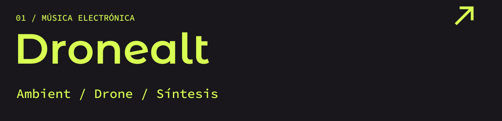
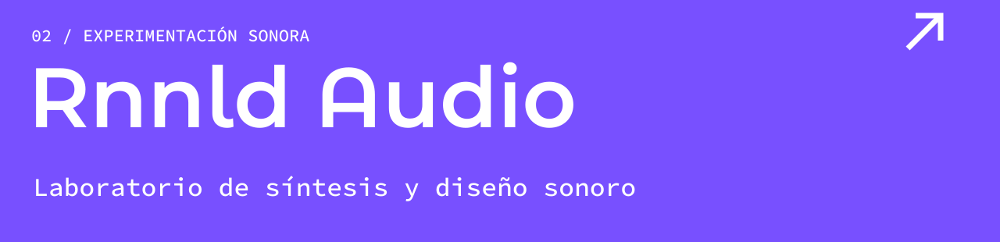
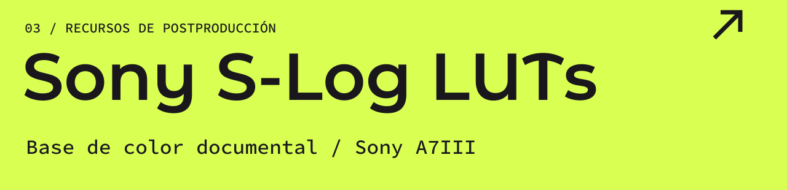
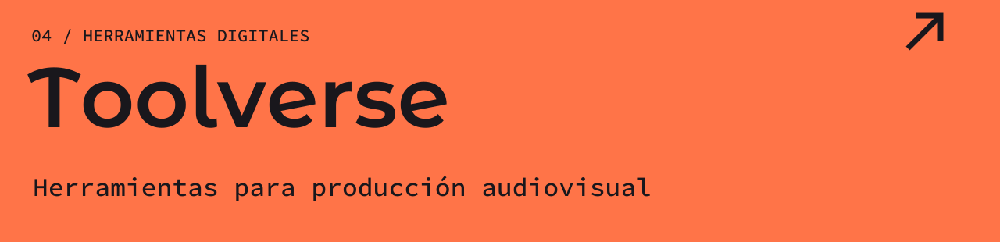
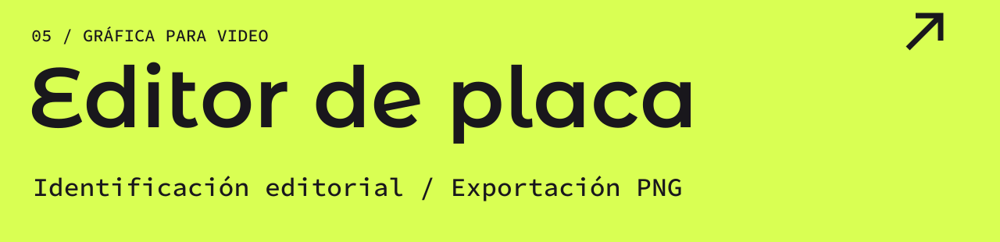
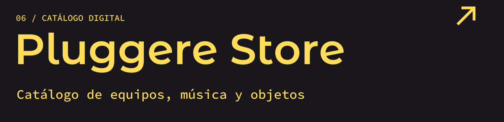

  

### [▶ VER REEL](https://youtu.be/rhUEiaQfEJ4) &nbsp; / &nbsp; [PORTAFOLIO ↗](https://github.com/guzmandavila/portfolio) &nbsp; / &nbsp; [ESCRÍBEME ↗](https://wa.me/593979864314)

**13+ años de experiencia** &nbsp; · &nbsp; Ecuador / Remoto &nbsp; · &nbsp; ES / EN

Soy **Ronald Guzmán Dávila**, productor audiovisual independiente. Dirijo, filmo y llevo cada historia hasta su entrega final: edición, color y sonido. Trabajo en documental y contenido editorial, en campo y con equipos distribuidos.

[Trabajo audiovisual](#user-content-audiovisual) &nbsp; / &nbsp; [Proyectos propios](#user-content-proyectos) &nbsp; / &nbsp; [Servicios](#user-content-servicios)

 

<h2></h2>

**PARAÍSOS ESCONDIDOS DEL ECUADOR**  
Serie documental / Revista Vistazo / 6+ episodios  
Producción · Dirección de fotografía · Edición · Color · Sonido

[▶ Ver reel](https://youtu.be/rhUEiaQfEJ4)

 

**CHIMBORAZO / DOCUMENTAL SOBRE EL CLIMA**  
Revista Vistazo  
Producción · Cámara · Edición · Color · Audio post · Entrega

[▶ Ver documental](https://www.youtube.com/watch?v=ObqKy5h2I38)

 

<h2></h2>

[Dronealt](https://github.com/guzmandavila/dronealt) · [Rnnld Audio](https://github.com/guzmandavila/rnnld-audio) · [Sony S-Log LUTs](https://github.com/guzmandavila/sony-slog-luts) · [Toolverse](https://github.com/guzmandavila/toolverse) · [Editor de placa](https://github.com/guzmandavila/Editor-de-placa) · [Pluggere Store](https://github.com/guzmandavila/pluggerestore)

 

<h2></h2>

**Producción y dirección de fotografía**  
Producción de campo, dirección de fotografía y logística de rodaje para documental y contenido editorial. Experiencia en locaciones remotas, incluida la Amazonía.

**Edición y color**  
Montaje y construcción narrativa, corrección de color y grading. Preparación de másters y control de calidad para broadcast y streaming.

**Postproducción de audio**  
Edición, limpieza y restauración de diálogo. Diseño sonoro, mezcla y masterización.

 

**Periplo Studio** / Estudio independiente de producción y postproducción audiovisual, enfocado en documental, contenido editorial y servicios de color para proyectos de terceros.

Herramientas y flujos de postproducción

 

DaVinci Resolve Studio · Pro Tools Studio · Premiere Pro · After Effects

S-Log2 / S-Log3 · Gestión de color ACES · Másters para broadcast y streaming

 

<h2></h2>

Disponible para proyectos de documental, postproducción y color.

### [Escríbeme ↗](https://wa.me/593979864314)

[LinkedIn](https://www.linkedin.com/in/ronaldgdavila/) &nbsp; / &nbsp; [Instagram](https://www.instagram.com/guzzmandro/) &nbsp; / &nbsp; [Portfolio in English](https://github.com/guzmandavila/portfolio/blob/main/PORTFOLIO_EN.md)
