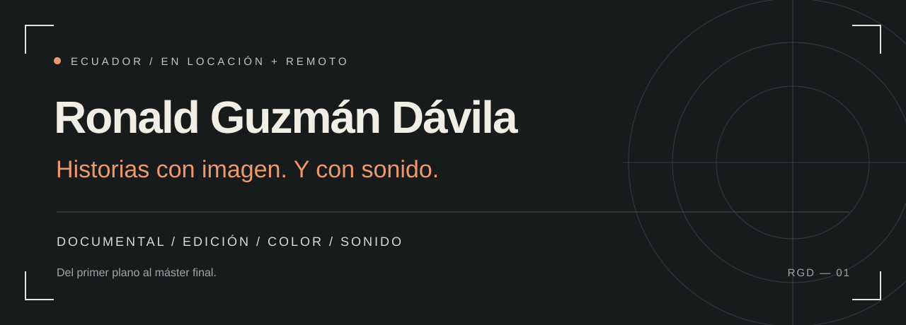

  

  <a href="https://youtu.be/rhUEiaQfEJ4"><strong>Ver showreel ↗</strong></a>
  &nbsp; / &nbsp;
  <a href="https://github.com/guzmandavila/portfolio/blob/main/PORTFOLIO_EN.md">Portafolio</a>
  &nbsp; / &nbsp;
  <a href="mailto:rnnld@periplostudio.com">Hablemos de tu proyecto</a>

  13+ años de experiencia &nbsp; · &nbsp; 5+ años en remoto &nbsp; · &nbsp; Ecuador &nbsp; · &nbsp; ES / EN

 

### Del territorio a la pantalla

Soy productor audiovisual independiente. Dirijo y filmo documental y contenido editorial, y acompaño cada historia hasta su entrega final: **edición, color y sonido**.

Trabajo en locaciones remotas y con equipos distribuidos. Un solo interlocutor, desde el rodaje hasta el máster para broadcast y streaming.

 

### Trabajo seleccionado

**SHOWREEL** &nbsp; [Reproducir ↗](https://youtu.be/rhUEiaQfEJ4)  
Una mirada a mi trabajo en producción, cámara y postproducción.

---

**01 / Paraísos Escondidos del Ecuador**  
*Serie documental · Revista Vistazo*

Producción y dirección de fotografía en una serie de 6+ episodios. Rodajes en locaciones remotas, incluida la Amazonía, y postproducción completa: edición, color y sonido.

**02 / Documental sobre el clima — Chimborazo**  
*Revista Vistazo · Producción / Cámara / Postproducción*

Del trabajo de campo a la entrega final. [Ver documental ↗](https://www.youtube.com/watch?v=ObqKy5h2I38)

**03 / Periplo Studio**  
*Fundador · Producción y postproducción*

Mi espacio de trabajo para documental, contenido editorial y color para otros realizadores.

 

### Cómo puedo sumarme

**Producción**  
Dirección y fotografía · Producción de campo · Logística en locaciones remotas.

**Postproducción y color**  
Edición y construcción narrativa · Corrección de color y grading · Másters y control de calidad.

**Sonido**  
Diseño sonoro · Limpieza y restauración de diálogo · Mezcla y masterización.

 

### En la sala de post

**DaVinci Resolve Studio / Pro Tools Studio / Premiere Pro / After Effects**

S-Log2 / S-Log3 · Gestión de color ACES · Entregables para broadcast y streaming

---

### ¿Tienes una historia en marcha?

Disponible para colaboraciones en documental, postproducción y color.

**[rnnld@periplostudio.com](mailto:rnnld@periplostudio.com)** ↗

[LinkedIn](https://www.linkedin.com/in/ronaldgdavila/) &nbsp; · &nbsp; [Instagram](https://www.instagram.com/guzzmandro/) &nbsp; · &nbsp; [Portfolio in English](https://github.com/guzmandavila/portfolio/blob/main/PORTFOLIO_EN.md)
